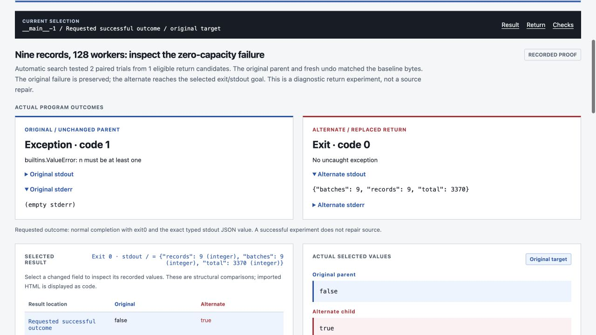
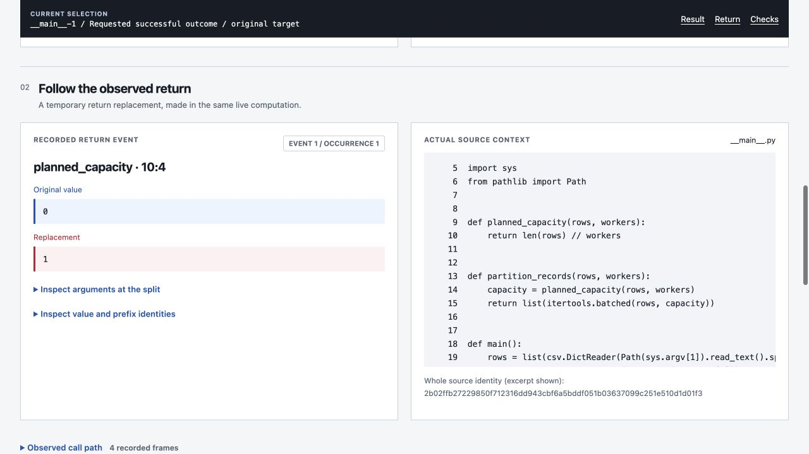

# Aetiory

**Diagnose failed Python runs by testing an earlier return.**

[](docs/EXECUTION.md)
[](docs/EXECUTION.md)
[](pyproject.toml)
[](LICENSE)

At a selected return, Aetiory forks the live computation. One process keeps the
original value; the other gets a replacement. It compares the result, replays the
experiment, and runs an unchanged control. Source files stay unchanged.



Nine records,128 workers: the owned example returns a batch capacity of0 and
raises `ValueError`. Replacing that return with1 reaches exit0 and preserves all
nine records and their total of3370. This is a diagnostic experiment, not a patch.

[Inspect the recorded studio](https://nazeeh111.github.io/Aetiory/) ·
[Run this complete case](#try-the-complete-csv-investigation) ·
[Download](https://github.com/nazeeh111/Aetiory/releases) ·
[Agent tools](docs/AGENTS.md)

The CLI executes trusted local Python. The studio only inspects records, with
original/alternate output, selected return, observed callers and guard receipts.
No model API or runtime dependencies.

The public CSV record replaces local checkout paths in exception frames with
repository-relative paths. Its displayed artifact hash identifies that published
copy; the recorded execution and replay guards were checked against the original
bytes before this path redaction.

## Start locally

Python 3.11+ on Linux or macOS. Use trusted, synchronous Python programs with
fork-compatible state. A native process fork copies live computational memory;
it does not roll back files, network activity or other external effects.

```sh
python3 -m venv .venv
. .venv/bin/activate
python -m pip install --no-deps ./aetiory-0.2.2-py3-none-any.whl
aetiory --help
```

Download the wheel from Releases first, or install a source checkout with
`python -m pip install --no-deps .`. The source build needs setuptools;
the wheel has no runtime dependencies. Nothing registers an agent integration
or changes your application settings automatically.

## Try the complete CSV investigation

From a source checkout after installing Aetiory, use Python3.12+ for this example
(it uses `itertools.batched`). Every output directory must be new.

```sh
aetiory diagnose --script examples/partition_records.py \
  --input examples/inputs/records.csv \
  --arg "$(pwd)/examples/inputs/records.csv" --arg 128 \
  --stdout-pointer '' \
  --stdout-equals '{"records":9,"batches":9,"total":3370}' \
  --out experiments/batching
```

Open `experiments/batching/viewer/index.html` offline. Use **Result → Return →
Checks** to follow the same investigation:

| Inspect | Actual installed Python3.14 run |
|---|---|
| Original | `ValueError: n must be at least one`, exit1 |
| Selected return | `planned_capacity`, line10: `0 → 1` |
| Alternate | Exit0,9 records,9 batches,total3370 |
| Replay and control | Fresh paired replay reproduced both outcomes; fresh unchanged run matched the original bytes |



This run tested two paired trials from one eligible return candidate. It is an
owned workload with a retained defect. It is not an upstream bug, a customer
case, or a correctness proof for other inputs. Reproduction records the local
interpreter and source identities; different versions require a new observation.

## Diagnose your own failure

Run a trusted standalone source file unchanged:

```sh
aetiory diagnose --script your_program.py --out experiments/failure
```

Exit0 alone does not establish that the program did the right thing. For JSON
stdout, require the value you actually need:

```sh
aetiory diagnose --script your_program.py --out experiments/failure \
  --stdout-pointer /result --stdout-equals '{"count":9,"checksum":45}'
```

The entry is observed with real `__main__` identity. Select additional source
modules with `--module name=/absolute/source.py`, declare file inputs with
`--input`, and pass each target argument with `--arg=VALUE`.

`diagnosis.json` distinguishes `diagnosed`, `unresolved` and `refused`; CLI exit
codes are0,2 and3 respectively. A target exception is a captured outcome; an
engine refusal, unsupported stream, quota exhaustion or timeout is not.
Stdout and stderr are each limited to128KiB of strict UTF-8, including output
emitted before the split. Retained trials, source context, observed callers,
fresh replay and unchanged control stay together in the portable viewer.

For separate capture and search, use `observe --capture-outcome`, then
`search --successful-exit` with an optional stdout predicate.

## From an artifact to an experiment

Your entry script reads declared inputs, calls explicitly selected Python modules,
then writes a relative artifact. Sources stay unchanged; instrumentation happens
in memory. Each output directory must be new.

```sh
aetiory observe \
  --script examples/compare_sources.py \
  --module "difflib=/absolute/path/to/your/python/stdlib/difflib.py" \
  --input examples/inputs/verifier-0.1.1.py \
  --input examples/inputs/verifier-0.1.2.py \
  --arg /absolute/path/to/examples/inputs/verifier-0.1.1.py \
  --arg /absolute/path/to/examples/inputs/verifier-0.1.2.py \
  --artifact artifact.html --out experiments/observed

aetiory search --observation experiments/observed/observation.json \
  --html-id from0_72 --html-next-sibling 1 \
  --out experiments/searched --max-trials 128 --seconds 600

aetiory replay --plan experiments/searched/intervention.json \
  --out experiments/replayed

aetiory export --observation experiments/observed/observation.json \
  --search experiments/searched/search.json --replay experiments/replayed/replay.json \
  --out experiments/viewer
```

The export is one self-contained HTML file and a companion JSON record. Open the
HTML offline, inspect actual values and download the exact original/alternate
artifact bytes. Sharing is voluntary; inspect the record for your own sensitive
source or data before sharing it. There is no telemetry or automatic upload.

For a complete reproduction without manually resolving paths:

```sh
python examples/run_cases.py --out experiments/cases
```

This runs both real examples against the current installed Python's unmodified
standard-library sources. It retains failed/no-effect trials too. Different
interpreters or input versions require new observations; an old plan is not
silently relocated or rewritten. Large traces and repeated executions can take
minutes. An unresolved search is an honest result.

## Two failure investigations

| Program | Original outcome | Verified alternate |
|---|---|---|
| Scientific CLI through unchanged CPython3.13 `argparse` | Negative scientific notation is interpreted as an option; exit2 | The upstream option classifier returns `None`; exit0 and actual parsed `param=-3e12` |
| Owned CSV partitioner,9 records over128 workers | Floor allocation returns0; `itertools.batched` raises `ValueError` | The entry's capacity return becomes1; all9 records and the full total remain verified |

The first reproduces [CPython#105712](https://github.com/python/cpython/issues/105712),
not a newly discovered defect. Python3.14 already accepts this input, and passing
`-p=-3e12` is a simpler workaround. The second is an owned workload with a
retained defect, not a reported upstream bug or production customer. Both require
actual output, preserve the original failure and perform fresh replay/undo.

## Two concrete questions

| Question | Real input | What the experiment measures |
|---|---|---|
| Why did this HTML diff use an inline highlight? | The complete released Solidrift 0.1.1 and 0.1.2 verifier sources, through CPython `difflib` | Automatic upstream return search; stable code-cell selection and measured collateral |
| Which formatter return controls this nested value? | A full native geometry report, through CPython `pprint` | One selected parsed value changes, while other parsed fields stay equal |

The second experiment alters a rendered representation. It does not change or
repair the underlying native geometry. These examples establish the mechanism
on recorded runs, not complete causal understanding of arbitrary software.

## What makes a result count

1. Plain and instrumented baselines have identical complete artifact bytes.
2. Source, declared input, engine and interpreter identities still match.
3. The expected event, value, observed call ancestry and scoped return prefix match.
4. The paired parent reproduces the original artifact; the child changes the
   selected stable HTML element or parsed JSON/literal path.
5. A fresh replay reproduces both artifacts, and fresh unchanged execution matches
   the baseline. Native children are reaped; incomplete trials remain incomplete.

Candidate ranking is a search hint. Matching values or neighboring containers
do not establish influence. The prefix hashes complete portable observations
and explicit opaque type/location markers. It does not serialize the whole heap;
opaque objects, including paused Python iterators, are copied by the native fork.
Recorded hashes check consistency, not author authenticity.

## Supported boundary

The current engine is for trusted, single-threaded Python computation. At a split,
nonstandard open streams are refused. Python-level checks refuse network calls,
external child spawning and writes outside the active branch directory. These
checks are not an operating-system sandbox and do not protect you from malicious
source or arbitrary native code. Do not use it for live payment, device, browser,
GUI or network sessions.

Only explicitly selected Python source-module returns are instrumented. Native
extension internals, complete dataflow, global minimal explanations, source fixes
and arbitrary heap reconstruction are outside this release. Fixed text offsets
are available in the CLI but can shift when earlier output changes; use stable
HTML ids or parsed pointers for semantic selection.

## Inspect and contribute

```sh
python -m unittest discover -s tests -v
node aetiory/web/checks.mjs
node aetiory/web/controller-checks.mjs
```

See [evidence](docs/EVIDENCE.md), [the execution contract](docs/EXECUTION.md),
[the browser record schema](aetiory/web/API.md) and [security reporting](SECURITY.md).
Useful issues include a small trusted example, exact source/input identities,
observed versus expected behavior, and a retained refusal or trial receipt.

MIT for the original implementation. CPython source excerpts retain the PSF
license; native sample provenance retains its Manifold Apache-2.0 notice.
[Third-party notices](THIRD_PARTY_NOTICES.md) explain each included item.
