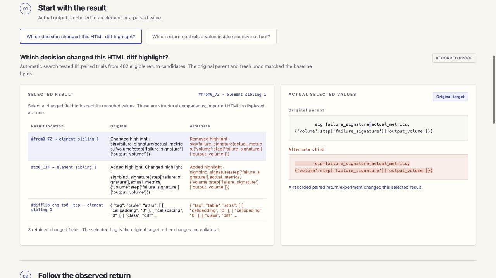

# Aetiory

**Choose an output. Find the Python decision that changes it. Replay the effect.**

Aetiory tests actual return decisions against a selected result. At a guarded return,
it forks the running computation: one process keeps the original value, the other
gets a replacement. An influence counts only when the original process matches
the baseline, the selected output changes, and a fresh unchanged run restores
the original bytes.

No model API, runtime dependencies or source edits. A CLI runs the experiment;
four local agent tools expose the same engine. A read-only studio keeps the
output, source context, observed call path, collateral and checks together.



[Explore the recorded studio](https://nazeeh111.github.io/Aetiory/) ·
[Download a release](https://github.com/nazeeh111/Aetiory/releases) ·
[Agent integration](docs/AGENTS.md) · [Execution contract](docs/EXECUTION.md)

## Start locally

Python 3.11+ on Linux or macOS. Use trusted, synchronous Python programs with
fork-compatible state. A native process fork copies live computational memory;
it does not roll back files, network activity or other external effects.

```sh
python3 -m venv .venv
. .venv/bin/activate
python -m pip install --no-deps ./aetiory-0.1.0-py3-none-any.whl
aetiory --help
```

Download the wheel from Releases first, or install a source checkout with
`python -m pip install --no-deps .`. The source build needs setuptools;
the wheel has no runtime dependencies. Nothing registers an agent integration
or changes your application settings automatically.

## From an artifact to an experiment

Your entry script reads declared inputs, calls explicitly selected Python modules,
then writes a relative artifact. Sources stay unchanged; instrumentation happens
in memory. Each output directory must be new.

```sh
aetiory observe \
  --script examples/compare_sources.py \
  --module "difflib=/absolute/path/to/your/python/stdlib/difflib.py" \
  --input examples/inputs/verifier-0.1.1.py \
  --input examples/inputs/verifier-0.1.2.py \
  --arg /absolute/path/to/examples/inputs/verifier-0.1.1.py \
  --arg /absolute/path/to/examples/inputs/verifier-0.1.2.py \
  --artifact artifact.html --out experiments/observed

aetiory search --observation experiments/observed/observation.json \
  --html-id from0_72 --html-next-sibling 1 \
  --out experiments/searched --max-trials 128 --seconds 600

aetiory replay --plan experiments/searched/intervention.json \
  --out experiments/replayed

aetiory export --observation experiments/observed/observation.json \
  --search experiments/searched/search.json --replay experiments/replayed/replay.json \
  --out experiments/viewer
```

The export is one self-contained HTML file and a companion JSON record. Open the
HTML offline, inspect actual values and download the exact original/alternate
artifact bytes. Sharing is voluntary; inspect the record for your own sensitive
source or data before sharing it. There is no telemetry or automatic upload.

For a complete reproduction without manually resolving paths:

```sh
python examples/run_cases.py --out experiments/cases
```

This runs both real examples against the current installed Python's unmodified
standard-library sources. It retains failed/no-effect trials too. Different
interpreters or input versions require new observations; an old plan is not
silently relocated or rewritten. Large traces and repeated executions can take
minutes. An unresolved search is an honest result.

## Two concrete questions

| Question | Real input | What the experiment measures |
|---|---|---|
| Why did this HTML diff use an inline highlight? | The complete released Solidrift 0.1.1 and 0.1.2 verifier sources, through CPython `difflib` | Automatic upstream return search; stable code-cell selection and measured collateral |
| Which formatter return controls this nested value? | A full native geometry report, through CPython `pprint` | One selected parsed value changes, while other parsed fields stay equal |

The second experiment alters a rendered representation. It does not change or
repair the underlying native geometry. These examples establish the mechanism
on recorded runs, not complete causal understanding of arbitrary software.

## What makes a result count

1. Plain and instrumented baselines have identical complete artifact bytes.
2. Source, declared input, engine and interpreter identities still match.
3. The expected event, value, observed call ancestry and scoped return prefix match.
4. The paired parent reproduces the original artifact; the child changes the
   selected stable HTML element or parsed JSON/literal path.
5. A fresh replay reproduces both artifacts, and fresh unchanged execution matches
   the baseline. Native children are reaped; incomplete trials remain incomplete.

Candidate ranking is a search hint. Matching values or neighboring containers
do not establish influence. The prefix hashes complete portable observations
and explicit opaque type/location markers. It does not serialize the whole heap;
opaque objects, including paused Python iterators, are copied by the native fork.
Recorded hashes check consistency, not author authenticity.

## Supported boundary

The current engine is for trusted, single-threaded Python computation. At a split,
nonstandard open streams are refused. Python-level checks refuse network calls,
external child spawning and writes outside the active branch directory. These
checks are not an operating-system sandbox and do not protect you from malicious
source or arbitrary native code. Do not use it for live payment, device, browser,
GUI or network sessions.

Only explicitly selected Python source-module returns are instrumented. Native
extension internals, complete dataflow, global minimal explanations, source fixes
and arbitrary heap reconstruction are outside this release. Fixed text offsets
are available in the CLI but can shift when earlier output changes; use stable
HTML ids or parsed pointers for semantic selection.

## Inspect and contribute

```sh
python -m unittest discover -s tests -v
node aetiory/web/checks.mjs
node aetiory/web/controller-checks.mjs
```

See [evidence](docs/EVIDENCE.md), [the execution contract](docs/EXECUTION.md),
[the browser record schema](aetiory/web/API.md) and [security reporting](SECURITY.md).
Useful issues include a small trusted example, exact source/input identities,
observed versus expected behavior, and a retained refusal or trial receipt.

MIT for the original implementation. CPython source excerpts retain the PSF
license; native sample provenance retains its Manifold Apache-2.0 notice.
[Third-party notices](THIRD_PARTY_NOTICES.md) explain each included item.

If this workflow helps you investigate a real program, a reproducible case or
focused issue is especially valuable. Stars make the project easier to find.
